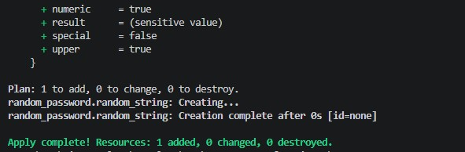
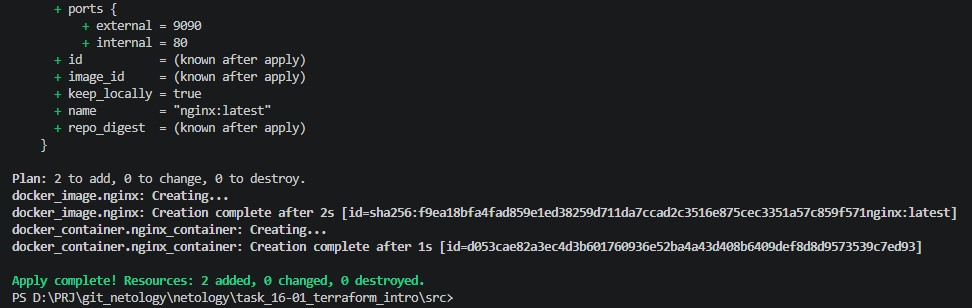
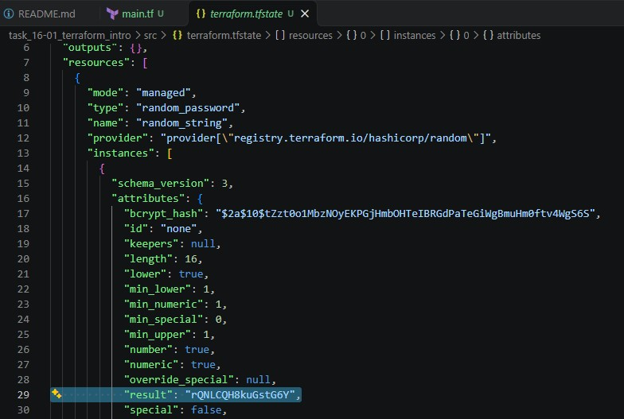
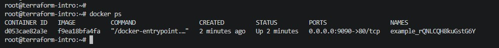
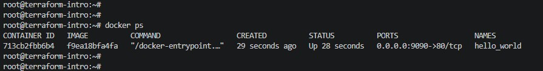
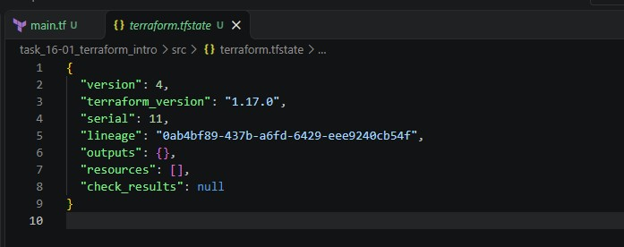

# 16-01. Введение в Terraform

Terraform 1.17.0 запускается на Windows-хосте; Docker-демон — в Vagrant-ВМ с Debian (10.10.10.3:2375). Связь через переменную окружения DOCKER_HOST.

## Задача 0. Версия Terraform

## Задача 1. Init, apply, tfstate

### 1.1. terraform init

Установка провайдера kreuzwerker/docker:

### 1.2. terraform apply

Apply complete! Resources: 2 added, 0 changed, 0 destroyed.

### 1.3. Пароль в tfstate

Сгенерированный ресурс random_password хранится в terraform.tfstate в открытом виде:

### 1.4. Ошибки в исходном коде

Три ошибки:

1. У блока resource "docker_image" отсутствовал второй label — имя ресурса. Каждый блок resource в HCL обязан иметь два label: тип и имя.
2. Имя ресурса 1nginx начиналось с цифры. Labels должны начинаться с буквы или символа подчёркивания.
3. В ссылке random_password.random_string_FAKE.resulT — несуществующее имя ресурса (random_string_FAKE вместо random_string) и неверный регистр атрибута (resulT вместо result). Terraform чувствителен к регистру в ссылках на атрибуты.

Исправленный код:

+++hcl
terraform {
  required_providers {
    docker = {
      source  = "kreuzwerker/docker"
    }
  }
  required_version = ">= 1.12.0"
}
provider "docker" {}

resource "random_password" "random_string" {
  length      = 16
  special     = false
  min_upper   = 1
  min_lower   = 1
  min_numeric = 1
}

resource "docker_image" "nginx" {
  name         = "nginx:latest"
  keep_locally = true
}

resource "docker_container" "nginx_container" {
  image = docker_image.nginx.image_id
  name  = "example_${random_password.random_string.result}"

  ports {
    internal = 80
    external = 9090
  }
}
+++

## Задача 2. docker ps и переименование

### 2.1. Контейнер после apply

### 2.2. Переименование в hello_world

В main.tf изменён атрибут name:

+++hcl
  name  = "hello_world"
+++

После apply:

План apply показал 1 to add, 0 to change, 1 to destroy: Terraform не переименовал контейнер, а пересоздал его. Причина — атрибут name входит в идентичность ресурса docker_container, смена имени означает уничтожение старого контейнера и создание нового.

### 2.3. Флаг -auto-approve

Флаг -auto-approve пропускает интерактивное подтверждение плана — Terraform применяет изменения без запроса yes. Удобно в CI/CD, рискованно в ручной работе: план не проверяется перед применением.

## Задача 3. Destroy

Destroy complete! Resources: 3 destroyed.

Проверка в ВМ:

+++text
# docker ps -a
CONTAINER ID   IMAGE     COMMAND   CREATED   STATUS    PORTS     NAMES
# docker images
nginx:latest   f9ea18bfa4fa   243MB   66.7MB
+++

Контейнер удалён; образ nginx:latest остался. Причина — keep_locally = true у ресурса docker_image: провайдер не удаляет образ из Docker при уничтожении ресурса.
Документация: https://registry.terraform.io/providers/kreuzwerker/docker/docs/resources/image

После destroy terraform.tfstate пуст:
