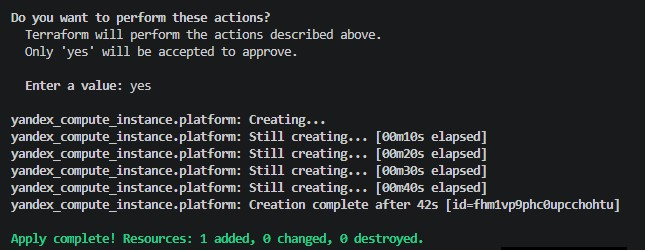
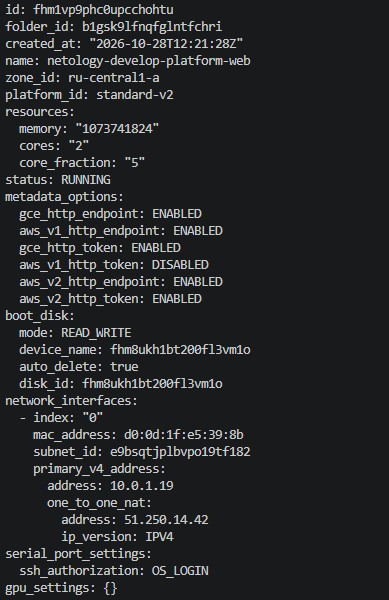
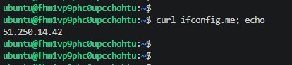
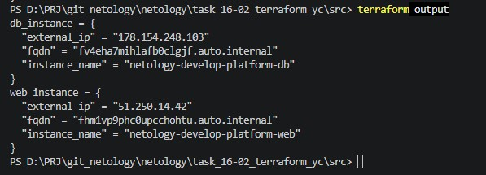

# 16-02. Основы Terraform. Yandex Cloud

Terraform 1.17.0 на Windows-хосте, провайдер yandex-cloud/yandex через зеркало. Ресурсы — в Yandex Cloud, каталог b1gsk9lfnqfglntfchri.

## Подготовка

- Сервисный аккаунт с ролью editor, ключ в creds/authorized_key.json.
- personal.auto.tfvars: cloud_id, folder_id, vms_ssh_root_key (в .gitignore).
- providers.tf: required_version >= 1.12.0, зеркало провайдера в .terraformrc.
- .gitignore: .terraform/*, *.tfstate*, personal.auto.tfvars, creds/.

## Задача 1. Init, ошибки исходника, apply

### 1.1. Ошибки в исходном main.tf

В исходнике два дефекта:

1. platform_id = "standart-v4" — опечатка «standart» вместо «standard» и несуществующая платформа v4. Провайдер отклоняет создание ВМ. Исправлено на "standard-v2".
2. cores = 1 недопустим для платформы standard-v2 (разрешены 2 и 4). Ошибка валидации от API. Исправлено на cores = 2.

### 1.2. terraform apply

Развернута инфраструктура



### 1.3. ВМ в консоли Yandex Cloud

Виртуальная машина создана



### 1.4. SSH и curl ifconfig.me

Внешний IP совпадает с указанным в консоли YC.



### 1.5. preemptible и core_fraction

preemptible = true — прерываемая ВМ: облако может остановить её в любой момент, непрерывная работа не гарантируется более 24 часов. core_fraction = 5 — гарантированная доля vCPU 5%, остальное — best-effort. Для обучения: стоимость ниже в разы, для SSH, curl и ручной настройки производительности хватает. Для продакшена не подходит: ВМ может быть вытеснена, а CPU-доля нестабильна под нагрузкой.

## Задача 2. Переменные vm_web_*

В variables.tf объявлены переменные с префиксом vm_web_: name, platform_id, cores, memory, core_fraction, preemptible, image_family. Все с type и default из прежних хардкод-значений. В main.tf хардкод заменён на var.vm_web_*.

```text
terraform plan
No changes. Your infrastructure matches the configuration.
```

## Задача 3. vms_platform.tf и вторая ВМ

Переменные web перенесены из variables.tf в vms_platform.tf, добавлены vm_db_* с параметрами: cores 2, memory 2, core_fraction 20, зона ru-central1-b. В main.tf добавлена подсеть develop_b и ресурс yandex_compute_instance.platform_db.

Отклонение: зона ru-central1-b на момент выполнения недоступна (инцидент в дата-центре Сасово). ВМ db и подсеть develop_b созданы в ru-central1-d. Концепция сохранена, ID ресурсов: подсеть fl8ekcl6da9l1u33oijc, ВМ fv4eha7mihlafb0clgjf.

```text
Apply complete! Resources: 2 added, 0 changed, 1 destroyed.
```

## Задача 4. outputs.tf

Объявлены два output — web_instance и db_instance, каждый содержит instance_name, external_ip, fqdn, все ссылками на ресурсы без хардкода. Вывод подтверждает, что значения формируются из атрибутов ресурсов.



## Задача 5. locals.tf

Имена ВМ собраны через locals с интерполяцией двух переменных:

```hcl
locals {
  web_name = "${var.vm_project}-${var.vpc_name}-platform-web"
  db_name  = "${var.vm_project}-${var.vpc_name}-platform-db"
}
```

В main.tf name заменён на local.web_name и local.db_name. Итоговые имена совпадают с текущими, пересоздания не требуется.

```text
terraform plan
No changes. Your infrastructure matches the configuration.
```

## Задача 6. Map-переменные

В vms_platform.tf объявлена map(object) vms_resources с полями cores, memory, core_fraction, hdd_size, hdd_type, preemptible для ключей web и db. Объявлена map(string) metadata, общая для обеих ВМ, значение — в personal.auto.tfvars (вне git). В main.tf блоки resources, boot_disk и scheduling_policy обеих ВМ переписаны на var.vms_resources["web"] и var.vms_resources["db"], блоки metadata — на var.metadata.

Неиспользуемые переменные vm_web_cores, vm_web_memory, vm_web_core_fraction, vm_web_preemptible, vm_db_cores, vm_db_memory, vm_db_core_fraction, vm_db_preemptible закомментированы. Оставлены используемые: vm_web_platform_id, vm_web_image_family, vm_db_platform_id.

```text
terraform plan
No changes. Your infrastructure matches the configuration.
```

## Ссылки

Репозиторий: https://github.com/NikolayModonov/devops-netology (ветка terraform-02)
Код: src/