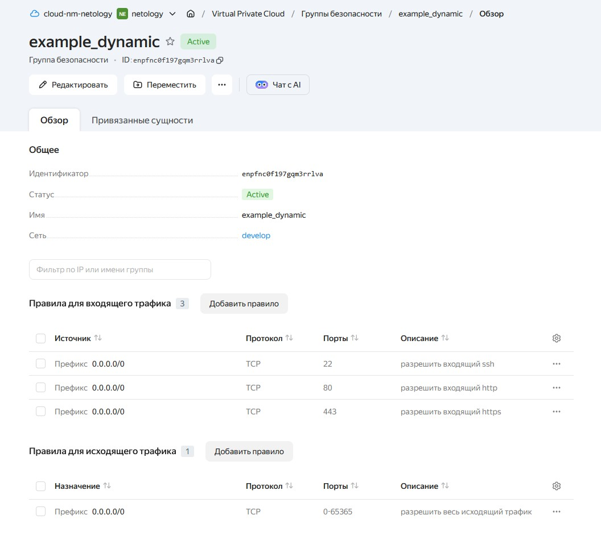
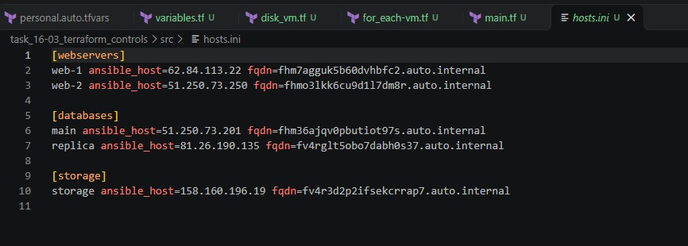

# 16-03. Управляющие конструкции в коде Terraform

Terraform 1.17.0 на Windows-хосте, провайдер yandex-cloud/yandex через зеркало. Ресурсы — в Yandex Cloud, каталог b1gsk9lfnqfglntfchri.

## Подготовка

- Исходник из 03/src: .gitignore, .terraformrc, providers.tf, variables.tf, main.tf, security.tf.
- providers.tf переведён на service_account_key_file, ключ в ../creds/authorized_key.json (вне git).
- personal.auto.tfvars: cloud_id, folder_id.
- SSH-ключ читается в locals.tf через file("~/.ssh/terraform-yc.pub") (задание 2.4).

## Задача 1. Группа безопасности

security.tf из шаблона: ресурс yandex_vpc_security_group.example с dynamic-блоками ingress и egress, правила из переменных security_group_ingress и security_group_egress.

Скриншот подтверждает создание группы безопасности с правилами для SSH, HTTP и HTTPS.



## Задача 2. count, for_each, depends_on, file()

### 2.1. count-vm.tf

Две одинаковые ВМ web-1 и web-2 через count, группа безопасности из задачи 1 подключена в network_interface.security_group_ids.

### 2.2. for_each-vm.tf

Две ВМ БД main и replica через for_each по переменной each_vm (list(object) с полями vm_name, cpu, ram, disk_volume, zone). Параметры разные: main — 2 CPU, 2 ГБ RAM, 5 ГБ диск; replica — 2 CPU, 4 ГБ RAM, 5 ГБ диск.

### 2.3. Порядок создания

У ресурса web задан depends_on = [yandex_compute_instance.db], ВМ из count-vm.tf создаются после ВМ из for_each-vm.tf.

### 2.4. SSH-ключ через file()

В locals.tf:

```hcl
locals {
  ssh_key  = file("~/.ssh/terraform-yc.pub")
  metadata = {
    serial-port-enable = "1"
    ssh-keys           = "ubuntu:${local.ssh_key}"
  }
}
```

Значение используется в блоке metadata всех ВМ.

## Задача 3. Диски и dynamic secondary_disk

В disk_vm.tf три одинаковых диска по 1 ГБ через yandex_compute_disk + count. ВМ storage создана без count и for_each, дополнительные диски подключены через dynamic "secondary_disk" с for_each по ресурсу yandex_compute_disk.extra.

## Задача 4. Ansible inventory

В ansible.tf ресурс local_file.hosts формирует файл hosts.ini через templatefile и шаблон hosts.tftpl. В шаблон передаются три списка: webservers (из count), databases (из for_each), storage. Для каждой ВМ выводятся name, ansible_host (nat_ip_address) и fqdn.

Инвентарь динамический: циклы for обрабатывают любое количество ВМ в каждой группе.

Скриншот подтверждает генерацию inventory-файла с тремя группами и пятью ВМ.



## Отклонения от задания

1. Квота HDD-дисков — 20 ГБ на зону. Все ВМ в ru-central1-a не помещаются. Часть ресурсов (replica, storage, дополнительные диски) размещена в ru-central1-d, добавлена подсеть develop_d (10.0.2.0/24). Boot-диски уменьшены до 5 ГБ.
2. В переменную each_vm добавлено поле zone для выбора подсети.

