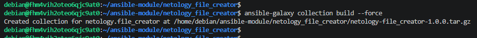
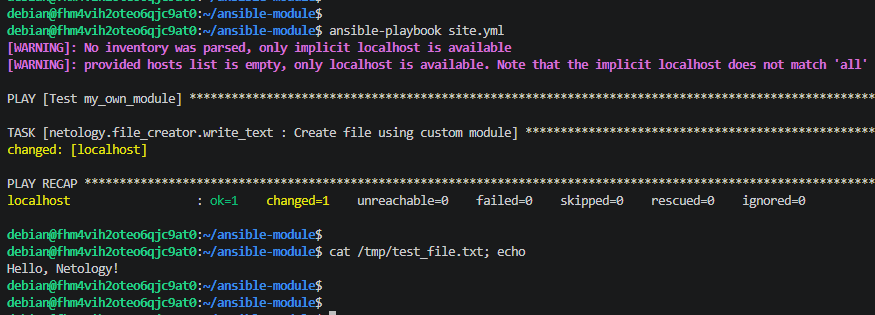

# Домашнее задание к занятию 6 «Создание собственных модулей»

## Ссылка на репозиторий
Код и собранный архив коллекции: [task_17-02_ansible_module](https://github.com/NikolayModonov/netology/tree/main/task_17-02_ansible_module)

## Что сделано

1. Написан кастомный модуль `my_own_module.py` на Python. Модуль создает текстовый файл с заданным содержимым (принимает параметры `path` и `content`), поддерживает `check_mode` и является идемпотентным.
2. Создана роль `write_text`, которая вызывает этот модуль.
3. Создана коллекция `netology.file_creator` (описан файл `galaxy.yml`).
4. Коллекция успешно собрана в архив `netology-file_creator-1.0.0.tar.gz` (приложен в папку `src/ansible-module`).
5. Написан плейбук `site.yml` для проверки работы коллекции.

## Скриншоты

Сборка коллекции:

Установка коллекции, запуск плейбука и результат работы модуля (созданный файл):

