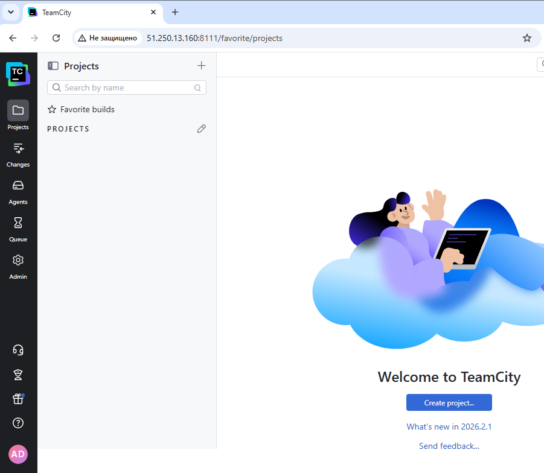
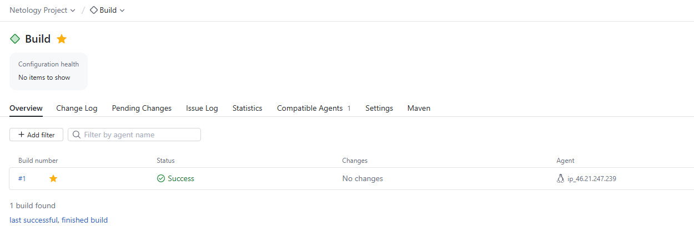
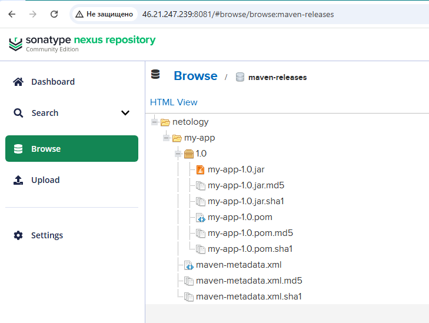
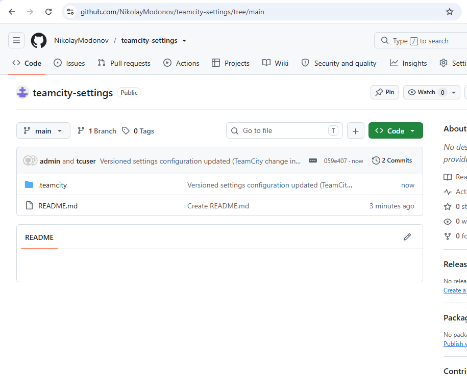

# Домашнее задание к занятию 5 «Непрерывная разработка и интеграция» (TeamCity)

## Что сделано

1. В Yandex Cloud развернуты две ВМ (Ubuntu 22.04).
2. На первой ВМ развернут TeamCity Server, на второй — Nexus Repository (Maven).
3. Настроен Maven-проект (лежит в папке `src/maven-project`), написана сборка `clean deploy`.
4. В Nexus создан репозиторий `maven-releases` с политикой Release. Артефакт `my-app-1.0.jar` успешно собран и загружен в Nexus.
5. Настроена синхронизация настроек TeamCity в отдельный репозиторий `teamcity-settings` в формате Kotlin DSL.

## Ссылки

Репозиторий с Kotlin-настройками TeamCity: [teamcity-settings](https://github.com/NikolayModonov/teamcity-settings)

## Скриншоты

