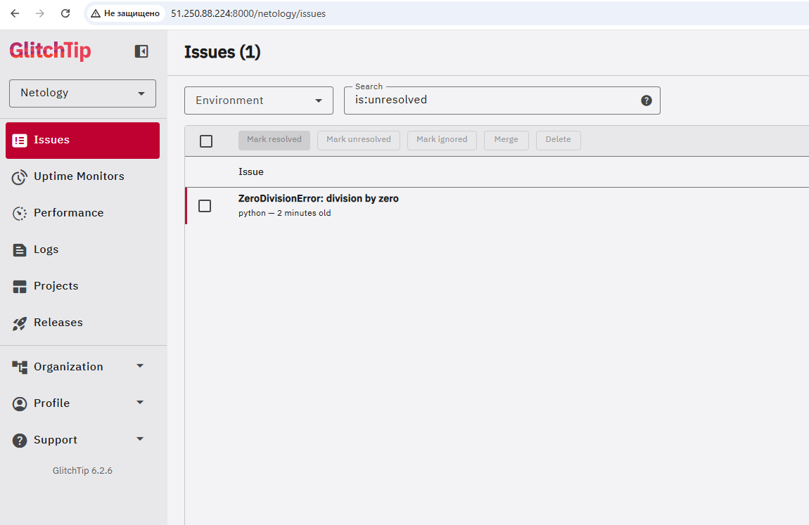
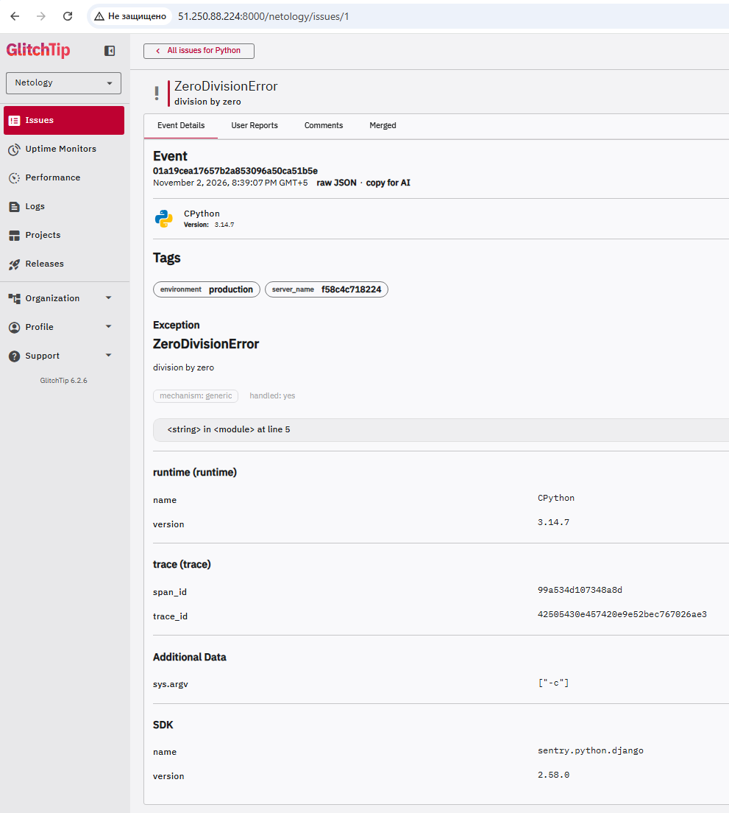
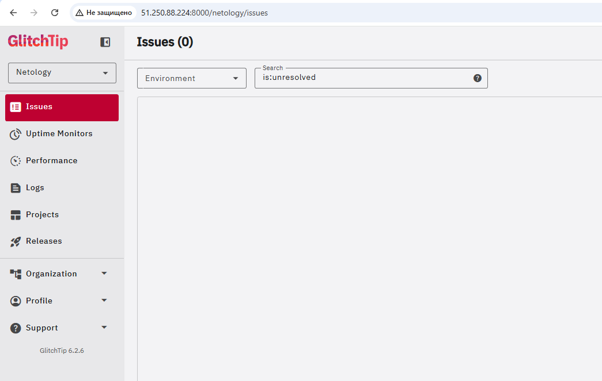
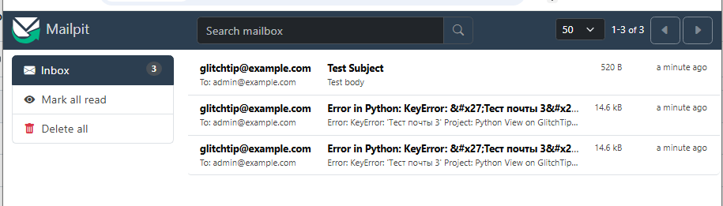

# Домашнее задание к занятию 5 «Мониторинг и логи» (Sentry)

## Важное примечание
Официальный облачный сервис Sentry (sentry.io) блокирует доступ с российских IP (403 Forbidden). Разворачивание self-hosted Sentry требует от 16 ГБ ОЗУ. 
В связи с этим, согласно ответу эксперта (разрешено использовать аналоги), задание выполнено на легковесном open-source аналоге **GlitchTip**, который совместим с SDK Sentry (Python).

## Что сделано

1. Развернута ВМ в Yandex Cloud (Ubuntu 22.04).
2. Через `docker-compose` развернут стек GlitchTip: `web` (веб-интерфейс), `worker` (обработчик), `postgres` (БД), `redis` (кэш) и `mailpit` (тестовый SMTP-сервер для перехвата писем).
3. Создан проект `Python`, сгенерировано тестовое событие `ZeroDivisionError` через `sentry-sdk`.
4. Настроено правило алертинга (1 событие за 1 минуту). Сгенерировано событие `KeyError`, по которому успешно отправлено почтовое уведомление.

## Скриншоты

Список проектов в GlitchTip:

Stack trace ошибки ZeroDivisionError:

Статус Resolved (пустой список):

Письмо с алертом в Mailpit:

