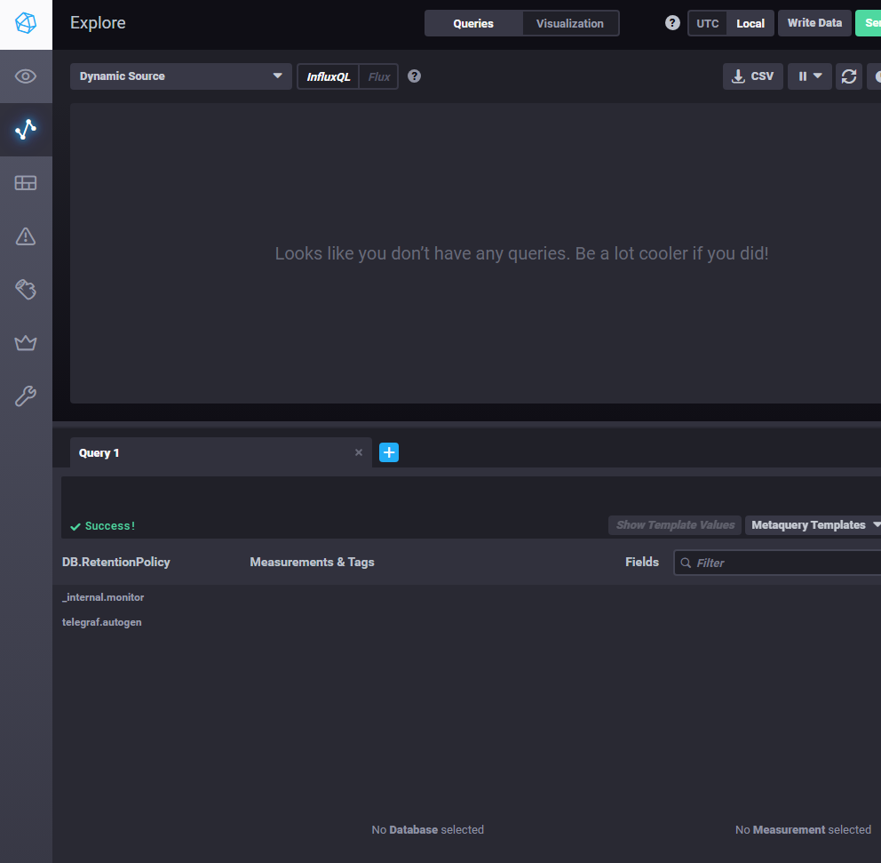
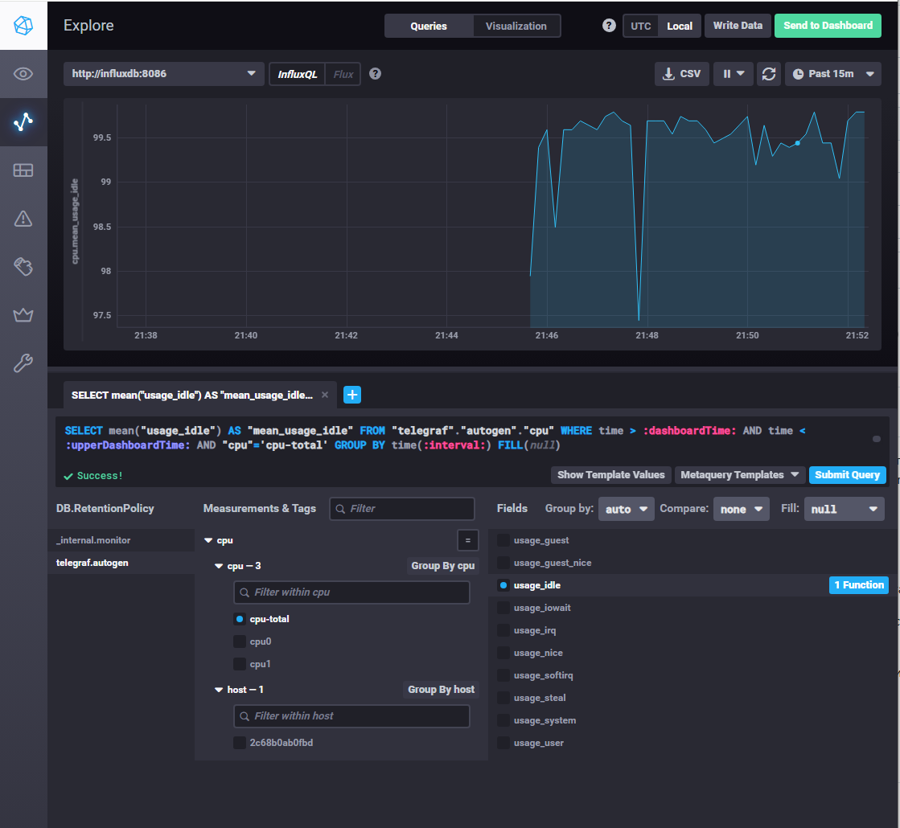
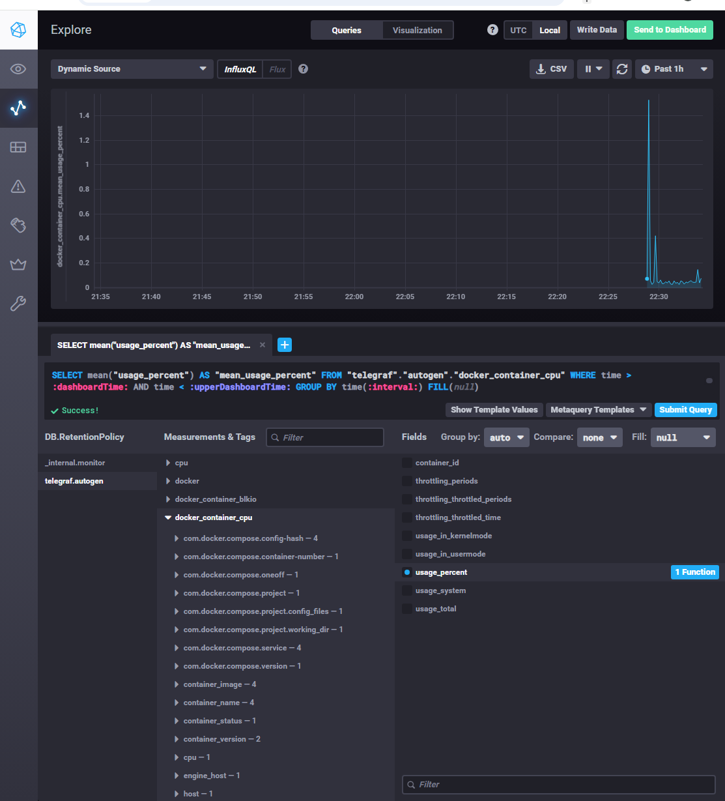

# Домашнее задание к занятию «Системы мониторинга»

## Задание 1. Минимальный набор метрик

Для платформы вычислений с отчетами на диск, HTTP-интерфейсом и нагрузкой на CPU минимальный набор метрик включает:
1. **CPU (Load Average, usage):** Вычислительные задачи сильно нагружают процессор, нужно отслеживать утилизацию и LA, чтобы не допустить деградации.
2. **RAM/Swap:** Вычисления могут приводить к утечкам памяти или резкому росту потребления.
3. **Disk Space и Inodes:** Отчеты занимают место, нужно следить за заполнением ФС.
4. **Disk I/O:** Запись отчетов на диск создает нагрузку на дисковую подсистему.
5. **Network Traffic:** Обработка HTTP-запросов требует контроля пропускной способности.
6. **HTTP-запросы (RPS, коды ответов 2xx/4xx/5xx, время ответа):** Главный показатель доступности и производительности платформы.

## Задание 2. Что предложить менеджеру

Менеджеру нужны не технические графики, а показатели качества обслуживания.
Необходимо предложить заключить **SLA** (соглашение об уровне обслуживания) с клиентом (например, доступность 99.9%).
Внутри системы мы будем опираться на **SLI** (индикаторы уровня обслуживания) — например, доля успешных запросов и время отклика, и **SLO** (цели уровня обслуживания) — внутренние цели, которые жестче SLA.

## Задание 3. Ошибка в расчете SLA

В формуле `summ_2xx_requests / summ_all_requests` ошибка кроется в том, что за 100% (знаменатель) принимаются **только** запросы, которые дошли до приложения. Если в системе нет ошибок 4xx/5xx, а SLA падает до 70%, значит, 30% запросов теряются на уровне сети, балансировщика или таймаутов, и не учитываются в метрике. Для корректного SLA в знаменатель нужно брать все входящие запросы.

## Задание 4. Сравнение Pull и Push моделей

*   **Pull (Prometheus, Zabbix):** Сервер сам опрашивает агенты. Плюсы: легче контролировать доступность самих агентов, централизованная конфигурация. Минусы: плохо работает в динамических средах, где агенты появляются и исчезают.
*   **Push (TICK, VictoriaMetrics):** Агенты сами отправляют данные. Плюсы: отлично подходит для динамических сред (Kubernetes, автоскейлинг). Минусы: сложнее отследить недоступность агента (он просто перестает слать данные, и это нужно настраивать отдельно), риск перегрузки сервера мониторинга.

## Задание 5. Классификация систем

*   **Pull:** Prometheus, Nagios, Zabbix (в основном).
*   **Push:** TICK (Telegraf), Graphite, VictoriaMetrics, Zabbix (может работать в обоих режимах).
*   **Гибрид:** Zabbix, VictoriaMetrics.

## Задание 6. Выбор системы мониторинга для компании

Для современной компании с динамической инфраструктурой (Docker, Kubernetes) лучше всего подойдет связка **Prometheus + Grafana + Alertmanager** (Pull модель). Для сбора логов — **ELK Stack** (Elasticsearch, Logstash, Kibana) или **Grafana Loki**. Для классической инфраструктуры с серверами — **Zabbix**.

## Задание 7. Развертывание TICK-стека

В Yandex Cloud развернута ВМ (Ubuntu 22.04), на которой через `docker-compose` запущен TICK-стек (Telegraf, InfluxDB 1.8, Chronograf, Kapacitor). 
Ниже представлен интерфейс Chronograf:

## Задание 8. Построение графика CPU

В Chronograf (Data Explorer) построен график утилизации CPU на основе метрик `usage_idle` от Telegraf:

## Задание 9. Настройка плагина Docker

В конфигурацию Telegraf добавлен плагин `inputs.docker`, который собирает метрики с сокета `/var/run/docker.sock`. На графике ниже отображены метрики контейнеров Docker:

