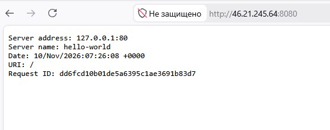
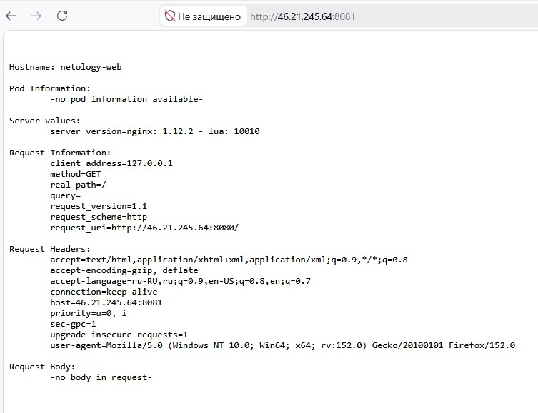

# Домашнее задание к занятию «Базовые объекты K8S»

## Задание 1. Создание Pod и Service

В кластере MicroK8S созданы два Pod'а (hello-world и netology-web), а также сервис netology-svc.
Для проверки работы приложений использован port-forward.

Скриншот подключения к поду hello-world на порту 8080:

Скриншот подключения к сервису netology-svc на порту 8081:

