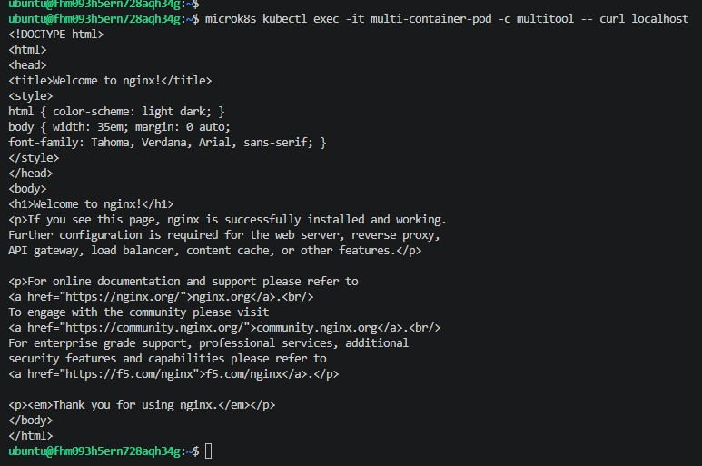

# Домашнее задание к занятию «Запуск приложений в K8S»

## Задание 1. Создание Pod с двумя контейнерами

Создан Pod `multi-container-pod`, внутри которого запущены два контейнера: `nginx` и `multitool`. 
Проверена сетевая связность: из контейнера `multitool` успешно выполнен запрос к локальному `nginx` по адресу `localhost`.

Скриншот выполнения запроса:

## Задание 2. Создание Deployment и Service

Создан Deployment `netology-deployment` с тремя репликами приложения Nginx.
Для доступа к приложению создан Service `netology-service` типа NodePort (порт 30080).
Проверена работоспособность: при обращении к внешнему IP виртуальной машины на порт 30080 открывается страница приветствия Nginx.

Скриншот доступа к приложению через браузер:

 