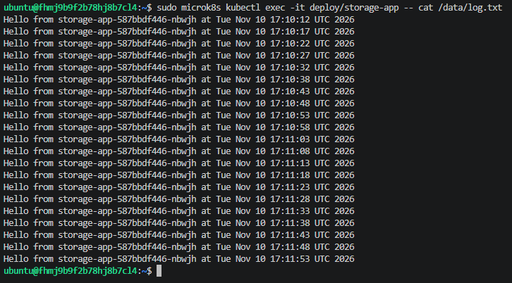

# Домашнее задание к занятию «Хранение в K8s»

## Задание 1. Создание PersistentVolume и PersistentVolumeClaim

На виртуальной машине развернут NFS-сервер. В кластере MicroK8S созданы ресурсы:
1. PersistentVolume (nfs-pv), использующий NFS-шару /srv/nfs/kubedata.
2. PersistentVolumeClaim (nfs-pvc), запрашивающий 1Gi хранилища с режимом ReadWriteMany.

## Задание 2. Подключение хранилища к приложению

Создан Deployment `storage-app`, который монтирует созданный PVC в директорию `/data`. Приложение циклически записывает текущее время в файл `/data/log.txt`.
Проверка через `kubectl exec` подтверждает, что данные успешно записываются на предоставленном томе.

Скриншот проверки записи логов:

