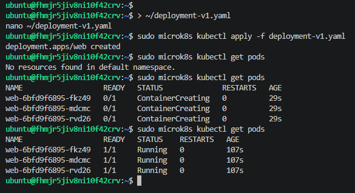
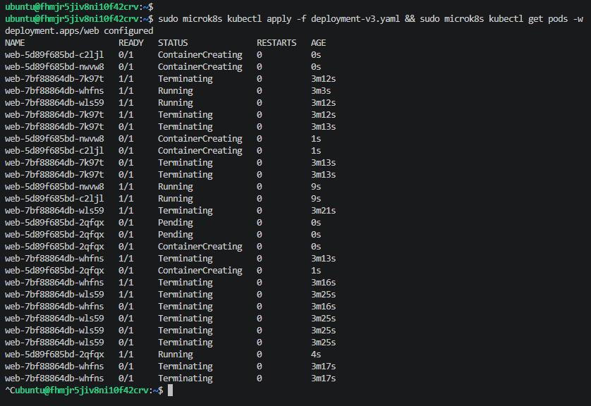
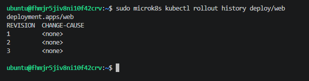

# Домашнее задание к занятию «Обновление приложений»

## Задание 1. Создание Deployment (версия 1)

Создан Deployment `web` с тремя репликами на базе образа `nginx:1.19`. Настроена стратегия обновления `RollingUpdate` с параметрами `maxSurge: 1` и `maxUnavailable: 1`.

Скриншот запущенных подов первой версии:

## Задание 2. Выполнение Rolling Update (версия 2)

В манифесте изменен тег образа на `nginx:1.23` и применены изменения. В процессе обновления видно, как Kubernetes постепенно создает новые поды и удаляет старые (статус `Terminating`), не прерывая работу приложения.

Скриншот процесса обновления:

## Задание 3. История обновлений

История развертываний сохранена в кластере.

Скриншот истории изменений:

