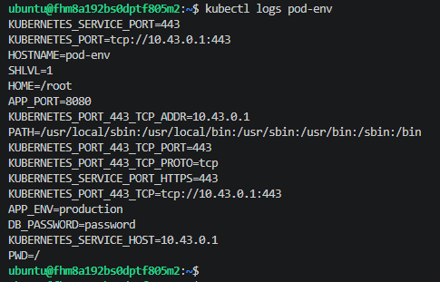
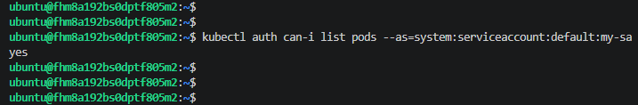

# Домашнее задание к занятию «Настройка приложений и управление доступом в Kubernetes»

## Задание 1. ConfigMap и Secret

Созданы объекты `app-config` (ConfigMap) и `app-secret` (Secret). 
Создан под `pod-env`, который с помощью директивы `envFrom` подтягивает все переменные из ConfigMap и Secret.

Скриншот логов пода, подтверждающий передачу переменных окружения (APP_ENV, DB_PASSWORD):

## Задание 2. RBAC (Управление доступом)

Созданы:
- ServiceAccount `my-sa`
- Role `pod-reader` (права на чтение подов)
- RoleBinding `read-pods` (связывает Role и ServiceAccount)

Скриншот проверки прав через `kubectl auth can-i`, подтверждающий, что сервисный аккаунт может просматривать поды:

