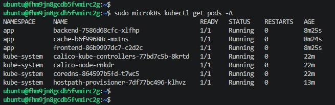
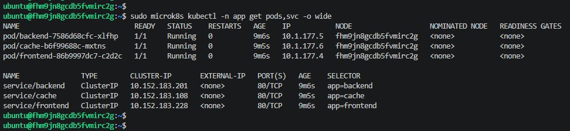
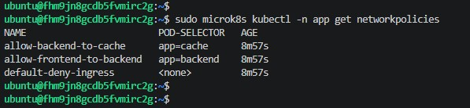
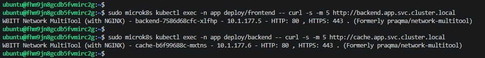
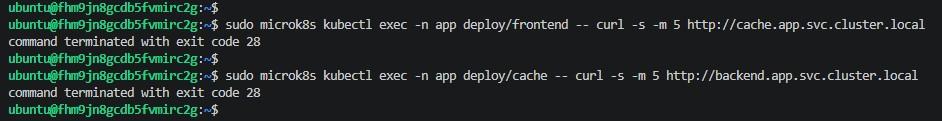

# 21-07 «Как работает сеть в Kubernetes»

Кластер: microk8s 1.28, один узел на ВМ YC (Ubuntu 22.04).
CNI: Calico — в microk8s 1.28 установлен по умолчанию и применяет NetworkPolicy из коробки.

## Задание

Создать deployment frontend, backend, cache, сервисы к ним и NetworkPolicy,
разрешающую трафик только по цепочке frontend -> backend -> cache.
Остальной трафик запрещён.

## Манифесты

Манифесты также сохранены в каталоге man репозитория.

namespace.yaml:

```
apiVersion: v1
kind: Namespace
metadata:
  name: app
```

deployments.yaml — deployment и service для frontend, backend, cache, образ wbitt/network-multitool:

```
apiVersion: apps/v1
kind: Deployment
metadata:
  name: frontend
  namespace: app
  labels:
    app: frontend
spec:
  replicas: 1
  selector:
    matchLabels:
      app: frontend
  template:
    metadata:
      labels:
        app: frontend
    spec:
      containers:
        - name: multitool
          image: wbitt/network-multitool:latest
          ports:
            - containerPort: 80
---
apiVersion: v1
kind: Service
metadata:
  name: frontend
  namespace: app
spec:
  selector:
    app: frontend
  ports:
    - port: 80
      targetPort: 80
---
apiVersion: apps/v1
kind: Deployment
metadata:
  name: backend
  namespace: app
  labels:
    app: backend
spec:
  replicas: 1
  selector:
    matchLabels:
      app: backend
  template:
    metadata:
      labels:
        app: backend
    spec:
      containers:
        - name: multitool
          image: wbitt/network-multitool:latest
          ports:
            - containerPort: 80
---
apiVersion: v1
kind: Service
metadata:
  name: backend
  namespace: app
spec:
  selector:
    app: backend
  ports:
    - port: 80
      targetPort: 80
---
apiVersion: apps/v1
kind: Deployment
metadata:
  name: cache
  namespace: app
  labels:
    app: cache
spec:
  replicas: 1
  selector:
    matchLabels:
      app: cache
  template:
    metadata:
      labels:
        app: cache
    spec:
      containers:
        - name: multitool
          image: wbitt/network-multitool:latest
          ports:
            - containerPort: 80
---
apiVersion: v1
kind: Service
metadata:
  name: cache
  namespace: app
spec:
  selector:
    app: cache
  ports:
    - port: 80
      targetPort: 80
```

policies.yaml — три политики:

- default-deny-ingress — запрещает весь входящий трафик для всех подов namespace app;
- allow-frontend-to-backend — разрешает подам backend принимать трафик только от подов с меткой app=frontend;
- allow-backend-to-cache — разрешает подам cache принимать трафик только от подов с меткой app=backend.

Политики ограничивают только входящий трафик (Ingress), исходящий не ограничен,
поэтому DNS-запросы подов продолжают работать.

```
apiVersion: networking.k8s.io/v1
kind: NetworkPolicy
metadata:
  name: default-deny-ingress
  namespace: app
spec:
  podSelector: {}
  policyTypes:
  - Ingress
---
apiVersion: networking.k8s.io/v1
kind: NetworkPolicy
metadata:
  name: allow-frontend-to-backend
  namespace: app
spec:
  podSelector:
    matchLabels:
      app: backend
  ingress:
  - from:
    - podSelector:
        matchLabels:
          app: frontend
---
apiVersion: networking.k8s.io/v1
kind: NetworkPolicy
metadata:
  name: allow-backend-to-cache
  namespace: app
spec:
  podSelector:
    matchLabels:
      app: cache
  ingress:
  - from:
    - podSelector:
        matchLabels:
          app: backend
```

## Применение

```
ubuntu@fhm9jn8gcdb5fvmirc2g:~$ sudo microk8s kubectl apply -f namespace.yaml
namespace/app created
ubuntu@fhm9jn8gcdb5fvmirc2g:~$ sudo microk8s kubectl apply -f deployments.yaml
deployment.apps/frontend created
service/frontend created
deployment.apps/backend created
service/backend created
deployment.apps/cache created
service/cache created
ubuntu@fhm9jn8gcdb5fvmirc2g:~$ sudo microk8s kubectl apply -f policies.yaml
networkpolicy.networking.k8s.io/default-deny-ingress created
networkpolicy.networking.k8s.io/allow-frontend-to-backend created
networkpolicy.networking.k8s.io/allow-backend-to-cache created
```

Поды кластера. Calico работает: calico-node и calico-kube-controllers в статусе Running.



Поды и сервисы namespace app:



Сетевые политики:



## Демонстрация трафика

Разрешённый трафик: frontend -> backend и backend -> cache, обе команды вернули ответ multitool.



Запрещённый трафик: frontend -> cache и cache -> backend, обе команды завершились с exit code 28 (таймаут) — трафик заблокирован политиками.

