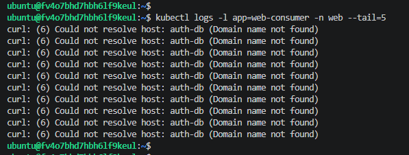
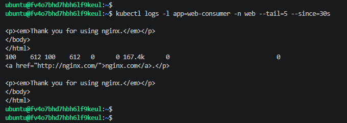

# Домашнее задание к занятию «Troubleshooting»

## Задание 1. Анализ и исправление ошибки

Исходный манифест содержал ошибку: под `web-consumer` (в namespace `web`) пытался обратиться к сервису `auth-db`, который находился в другом namespace (`data`). Из-за этого DNS не мог разрезолвить короткое имя.

Скриншот логов с ошибкой `Could not resolve host: auth-db`:

## Задание 2. Исправление

Для решения проблемы в команде `curl` было указано полное доменное имя (FQDN) сервиса: `auth-db.data.svc.cluster.local`. 
После применения исправленного манифеста поды успешно пересоздались и начали получать ответы от Nginx.

Скриншот логов с успешным ответом:

