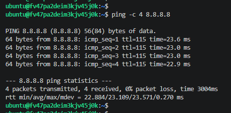
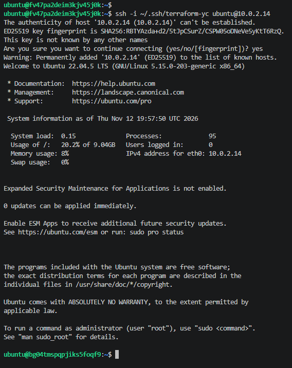
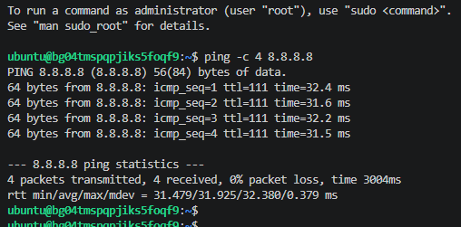

# Домашнее задание к занятию «Организация сети»

## Выполнение

В Yandex Cloud с помощью Terraform создана инфраструктура:
- VPC сеть `net`.
- Публичная подсеть `10.0.1.0/24` (зона ru-central1-a), в которой размещен NAT-инстанс (IP 10.0.1.254) с включенным IP-форвардингом и маскарадингом.
- Приватная подсеть `10.0.2.0/24` (зона ru-central1-e), таблица маршрутизации которой направляет весь трафик на NAT-инстанс.
- Подсеть `10.0.3.0/24` (зона ru-central1-d) для публичной ВМ.

Из-за жестких лимитов Yandex Cloud на диски, ресурсы распределены по трем разным зонам доступности. 
Публичная ВМ имеет выход в интернет напрямую, приватная ВМ не имеет публичного IP и выходит в интернет только через NAT-инстанс. Доступ к приватной ВМ осуществляется по SSH с публичной ВМ.

## Скриншоты

Проверка доступа в интернет с публичной ВМ:

Подключение к приватной ВМ по SSH через публичную ВМ:

Проверка доступа в интернет с приватной ВМ через NAT:

