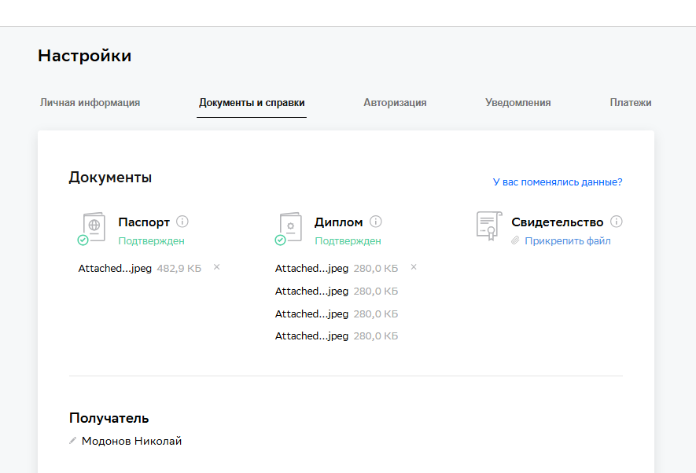

# Домашнее задание к занятию «Допуск к дипломной работе»

## Ответы на вопросы

**1. Получилось ли у вас загрузить в личный кабинет документы, подтверждающие личность, и диплом о высшем или среднем специальном образовании?**
Ответ: а) Да. Ссылка и скриншот ниже.

**2. Нужна ли вам справка об обучении после сдачи дипломной работы?**
Ответ: а) Да.

**3. Выполнен ли вами необходимый минимум заданий на каждом модуле профессии для допуска к дипломной работе?**
Ответ: а) Да.

## Скриншот личного кабинета

Ссылка на скриншот: [Скриншот личного кабинета](img/23-01_01_lk.png)

Скриншот личного кабинета:

